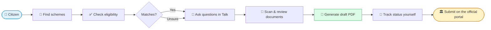
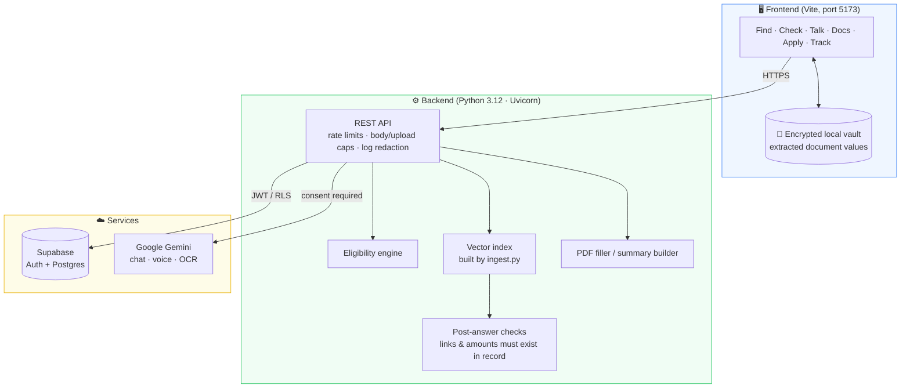
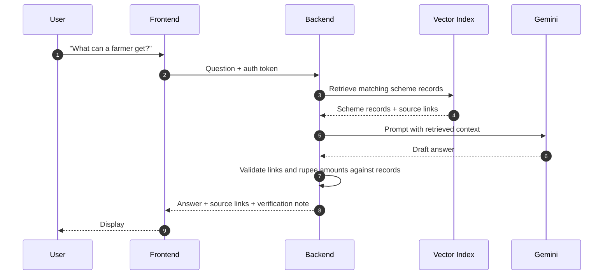
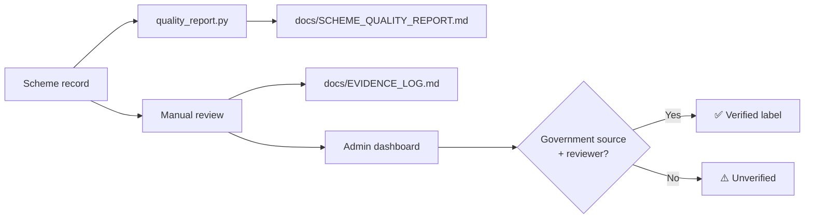

<div align="center">

# 🇮🇳 SchemeLocal

> **formerly MySchemeGuide**

### Find government schemes. Check eligibility. Prepare your application — in one place.

[](#-important-notice)
[](#-quick-start)
[](#-quick-start)
[](#-tech-stack)
[](#-supabase-setup)
[](#-privacy--consent)

[](#-testing)
[](#-testing)
[](#-data-quality--evidence)

</div>

### Find government schemes. Check eligibility. Prepare your application — in one place.

[](#-important-notice)
[](#-quick-start)
[](#-quick-start)
[](#-tech-stack)
[](#-supabase-setup)
[](#-privacy--consent)

[](#-testing)
[](#-testing)
[](#-data-quality--evidence)

</div>

---

## ⚠️ Important Notice

> **MySchemeGuide is a hackathon prototype.**
> It is **not** an official government service and it **never submits anything** to any government portal.
> All eligibility results are **indicative only** and never mean an official approval.
> Always confirm details on the scheme's official source link.

---

## 📑 Table of Contents

- [Features](#-features)
- [How It Works](#-how-it-works)
- [Architecture](#-architecture)
- [Tech Stack](#-tech-stack)
- [Quick Start](#-quick-start)
- [Environment Variables](#-environment-variables)
- [Supabase Setup](#-supabase-setup)
- [Demo Mode](#-demo-mode)
- [Privacy & Consent](#-privacy--consent)
- [Data Quality & Evidence](#-data-quality--evidence)
- [Testing](#-testing)
- [Deployment](#-deployment)
- [Roadmap](#-roadmap)
- [Known Limitations](#-known-limitations)
- [3-Minute Demo Script](#-3-minute-demo-script)

---

## ✨ Features

| | Module | What it does | Sign-in needed? |
|---|---|---|:---:|
| 🔎 | **Find** | Search and filter schemes; see status and the official source link for each | ❌ |
| ✅ | **Check** | Indicative eligibility on age, income, state, occupation, category and land. Shows matched, failed and unknown criteria | ❌ |
| 💬 | **Talk** | AI chat over the scheme data, with source links and a "not verified" note where it applies | ✔️ |
| 📄 | **Documents** | Photo scan (with explicit consent), then a review screen to correct values before saving | ✔️ |
| 📝 | **Apply** | Fills a bundled official PDF form where available, or creates a summary PDF. Drafts only | ✔️ |
| 📍 | **Track** | A status log you maintain yourself (not official government tracking) | ✔️ |
| 🛡️ | **Admin** *(optional)* | Verification dashboard for reviewers | ✔️ |

---

## 🔄 How It Works



> The final step is always **manual**: the app prepares you, the official portal receives your application.

---

## 🏗️ Architecture



### 🤖 Talk: answer pipeline



---

## 🧰 Tech Stack

| Layer | Technology |
|---|---|
| Frontend | Vite, TypeScript, Node 20 |
| Backend | Python 3.12, Uvicorn (ASGI) |
| Auth & database | Supabase (phone sign-in, Postgres with RLS) |
| AI | Google Gemini (chat, voice, OCR) |
| Retrieval | Local vector index built by `ingest.py` (downloads an embedding model on first run) |
| Hosting | Render (backend), Vercel (frontend) |

---

## 🚀 Quick Start

### 1️⃣ Backend (Python 3.12)

<<<<<<< HEAD
## Setup (2 commands)

**Windows (PowerShell):**
```powershell
.\scripts\setup.ps1    # installs deps, copies .env.example → .env if missing
.\scripts\run.ps1      # starts backend on :8000 and frontend on :5173 in parallel
```

**macOS / Linux (bash):**
```bash
bash scripts/setup.sh
bash scripts/run.sh
```

The app opens at **http://localhost:5173**. Find and Check work immediately without any keys.
To unlock Talk, Docs, Voice and Admin, fill in `backend/.env` and `frontend/.env` (see below).

### Manual setup (alternative)
Backend (Python 3.12+):
```bash
cd backend
python -m venv .venv && source .venv/bin/activate      # Windows: .venv\Scripts\activate
pip install -r requirements.txt
cp .env.example .env          # fill in values; see Environment Variables below
python ingest.py              # builds the vector index (first run downloads an embedding model)
uvicorn app:app --reload --port 8000
```

### 2️⃣ Frontend (Node 20)

```bash
cd frontend
npm ci
cp .env.example .env
npm run dev                   # http://localhost:5173
```

> 💡 Without a Gemini key the app shows clearly labelled fallback text.
> Without Supabase configured, protected screens (Docs, Apply, Track, Talk history) ask you to sign in and cannot be used.

---

## 🔑 Environment Variables

> Names only. **Values never go in git.**

<details>
<summary><b>Backend</b></summary>

| Variable | Variable | Variable |
|---|---|---|
| `ENV` | `GEMINI_API_KEY` | `SUPABASE_URL` |
| `SUPABASE_ANON_KEY` | `SUPABASE_SERVICE_ROLE_KEY` | `SUPABASE_JWT_SECRET` |
| `SUPER_ADMIN_PHONES` | `ALLOWED_SOURCE_DOMAINS` | `CORS_ORIGINS` |
| `TRUST_PROXY` | `FRESH_LOGIN_MINUTES` | `RATE_LIMIT_DEFAULT` |
| `RATE_LIMIT_AI` | `MAX_BODY_BYTES` | `MAX_UPLOAD_BYTES` |
| `GEMINI_TIMEOUT_S` | | |

</details>

<details>
<summary><b>Frontend</b></summary>

| Variable |
|---|
| `VITE_API_URL` |
| `VITE_SUPABASE_URL` |
| `VITE_SUPABASE_ANON_KEY` |
| `VITE_DEMO_MODE` |

</details>

> 🚨 The **service-role key is server-only**. Never put it in the frontend.

---

## 🗄️ Supabase Setup

1. Read `supabase/README.md`.
2. Run `supabase/migrations/0001_init.sql` in the Supabase SQL editor.
3. Configure an SMS provider in Supabase (required for phone sign-in).

### Seeding scheme data

```bash
# Validate and map all records without sending anything
python backend/tools/seed_supabase.py --dry-run
```

Without `--dry-run`, the script needs `SUPABASE_URL` and `SUPABASE_SERVICE_ROLE_KEY` in the environment (never committed).
Columns are read from `supabase/migrations/0001_init.sql`; extra source fields go into the `extra` column, and rejects are printed with reasons.

---

## 🎭 Demo Mode

Set `VITE_DEMO_MODE=true` in `frontend/.env`.

- A banner shows **"DEMO MODE – sample data only"**.
- Uses **synthetic** profile values only.
- Does **not** bypass sign-in, and creates no accounts or admin access.

---

## 🔒 Privacy & Consent

| Principle | How it is handled |
|---|---|
| **Consent first** | Document photos go to Google Gemini only after you tick the consent box. The server refuses processing without it |
| **No photo storage** | Photos are not stored on our server |
| **Local vault** | Extracted values are kept in your browser's encrypted local vault |
| **Your data, your control** | Export via `/api/me/export`; delete your account via `DELETE /api/me` |
| **Safe logs** | Logs redact Aadhaar, PAN, phone numbers and keys |
| **Chat memory** | Kept per signed-in user, expires after 30 idle minutes. `DELETE /api/ask/session/{id}` clears your own memory |

---

## 📊 Data Quality & Evidence



- **Verified count is currently `0`.** Only records marked *verified* in the admin dashboard, with a government source and a reviewer, carry that label.
- Tamil Nadu register entries are **names only**; details are pending.
- Non-government source domains show a **warning** in the app.
- Eligibility shows counts of checks met (for example "2 of 3 checks met"), **not** a probability of approval.
- Ambiguous answers (for example "lots" as income, or an unrecognised occupation) are reported as **unknown**, never pass or fail.
- AI answers are checked after generation: links must come from the retrieved scheme record, and rupee amounts must appear in it.
- Regenerate the report with `python backend/tools/quality_report.py`.

---

## 🧪 Testing

```bash
# Backend: 202 tests (auth, consent, RLS, eligibility, PDF, OCR upload checks)
cd backend && python -m pytest tests -q

# Frontend: 12 tests + type-check and production build
cd frontend && npm test
cd frontend && npm run build
```

> Some backend tests (RLS) need `pgserver`. Live Gemini, live Supabase and mobile devices have **not** been tested.

---

## 🌐 Deployment

| Target | Config | Notes |
|---|---|---|
| **Render** (backend) | `render.yaml` at the repository root | Render reads it there; `rootDir: backend` |
| **Vercel** (frontend) | `frontend/vercel.json` | Set the Vercel root directory to `frontend` |

---

## 🗺️ Roadmap

- [ ] Verify scheme records against government sources (verified count > 0)
- [ ] Complete Tamil Nadu scheme details
- [ ] Official portal integration
- [ ] Shared (non-in-memory) rate limiting
- [ ] Live testing of Gemini, Supabase and mobile devices

---

## ⚠️ Known Limitations

- Eligibility is **indicative** and never an official approval.
- Scheme data is limited and mostly unverified. Check the official source link.
- Voice input depends on the browser's speech support or Gemini.
- Rate limiting is per server instance, in memory.
- No official government portal integration exists; nothing is submitted for you.

---

## 🎬 3-Minute Demo Script

| Step | Screen | Action |
|:---:|---|---|
| 1 | **Home** | Open the app and confirm the demo banner is showing |
| 2 | **Find** | Search "agriculture"; open a scheme, note its verification label and source link |
| 3 | **Check** | Age 34, occupation farmer, income 150000, state Tamil Nadu; review matched, failed and unknown criteria |
| 4 | **Talk** | Ask "what can a farmer get?"; point out source links and the "not verified" note |
| 5 | **Documents** | Tick consent, upload a synthetic sample, correct any field, save |
| 6 | **Apply** | Generate the summary PDF; stress it is a draft, not a submission |
| 7 | **Track** | Add the application and change its status |

---

<div align="center">

