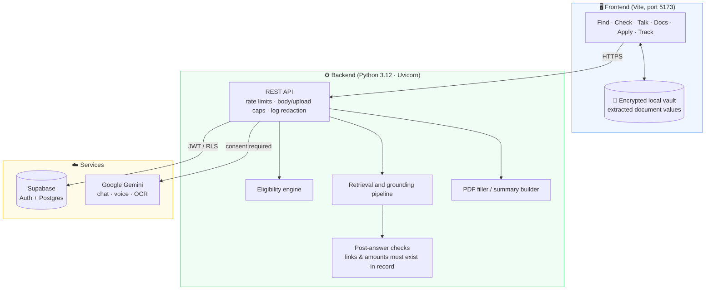
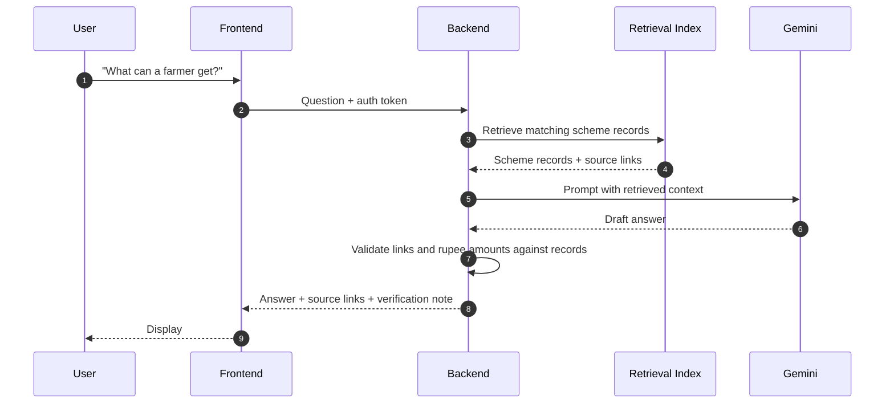
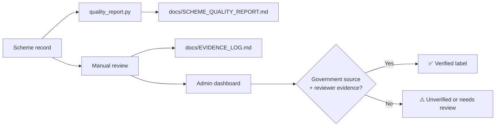

<div align="center">

# 🇮🇳 SchemeLocal

> **formerly MySchemeGuide**

### Find government schemes. Check eligibility. Prepare your application — in one place.

[](#-important-notice)
[](#-quick-start)
[](#-quick-start)
[](#-tech-stack)
[](#-supabase-setup)
[](#-privacy--consent)

[](#-data-quality--evidence)

</div>

---

## ⚠️ Important Notice

> **SchemeLocal is a hackathon prototype.**
> It is **not** an official government service and it **never submits anything** to any government portal.
> All eligibility results are **indicative only** and never mean an official approval.
> Always confirm details on the scheme's official source link.

---

## 📑 Table of Contents

- [Features](#-features)
- [How It Works](#-how-it-works)
- [Architecture](#-architecture)
- [Tech Stack](#-tech-stack)
- [Quick Start](#-quick-start)
- [Environment Variables](#-environment-variables)
- [Supabase Setup](#-supabase-setup)
- [Demo Mode](#-demo-mode)
- [Privacy & Consent](#-privacy--consent)
- [Data Quality & Evidence](#-data-quality--evidence)
- [Testing](#-testing)
- [Deployment](#-deployment)
- [Roadmap](#-roadmap)
- [Known Limitations](#-known-limitations)
- [3-Minute Demo Script](#-3-minute-demo-script)

---

## ✨ Features

| | Module | What it does | Sign-in needed? |
|---|---|---|:---:|
| 🔎 | **Find** | Search and filter schemes; see status and the official source link for each | ❌ |
| ✅ | **Check** | Indicative eligibility on age, income, state, occupation, category and land. Shows matched, failed and unknown criteria | ❌ |
| 💬 | **Talk** | AI chat over the scheme data, with source links and a "not verified" note where it applies | ✔️ |
| 📄 | **Documents** | Photo scan (with explicit consent), then a review screen to correct values before saving | ✔️ |
| 📝 | **Apply** | Fills a bundled official PDF form where available, or creates a summary PDF. Drafts only | ✔️ |
| 📍 | **Track** | A status log you maintain yourself (not official government tracking) | ✔️ |
| 🛡️ | **Admin** *(optional)* | Verification dashboard for reviewers | ✔️ |

---

## 🔄 How It Works


> The final step is always **manual**: the app prepares you, the official portal receives your application.

---

## 🏗️ Architecture



### 🤖 Talk: answer pipeline



---

## 🧰 Tech Stack

| Layer | Technology |
|---|---|
| Frontend | Vite, TypeScript, Node 20 |
| Backend | Python 3.12, Uvicorn (ASGI) |
| Auth & database | Supabase (phone sign-in, Postgres with RLS) |
| AI | Google Gemini (chat, voice, OCR) |
| Retrieval | Optional Chroma vector index, otherwise in-memory TF-IDF fallback |
| Hosting | Render (backend), Vercel (frontend) |

---

## 🚀 Quick Start

### 1️⃣ Backend (Python 3.12)

**Windows (PowerShell):**

```powershell
.\scripts\setup.ps1
.\scripts\run.ps1
```

**macOS / Linux (bash):**

```bash
bash scripts/setup.sh
bash scripts/run.sh
```

The app opens at **http://localhost:5173**. Scheme finding and eligibility checking work from the repository dataset; external providers are optional configuration.

### Manual setup

```bash
cd backend
python -m venv .venv
source .venv/bin/activate
pip install -r requirements.txt
cp .env.example .env
uvicorn app:app --reload --port 8000
```

### 2️⃣ Frontend (Node 20)

```bash
cd frontend
npm ci
cp .env.example .env
npm run dev
```

> 💡 Without a Gemini key, the app uses clearly labelled fallback behaviour where implemented.
> Without Supabase configured, protected screens require sign-in and cannot perform authenticated operations.

---

## 🔑 Environment Variables

> Names only. **Values never go in git.**

<details>
<summary><b>Backend</b></summary>

| Variable | Purpose |
|---|---|
| `ENV` | `development` or `production` |
| `GEMINI_API_KEY` | Google Gemini server credential |
| `SUPABASE_URL` | Supabase project URL |
| `SUPABASE_ANON_KEY` | Supabase anonymous key |
| `SUPABASE_SERVICE_ROLE_KEY` | Server-only Supabase credential |
| `SUPABASE_JWT_SECRET` | Optional legacy JWT secret; configure only if required |
| `SUPER_ADMIN_PHONES` | E.164 phone numbers bootstrapped as administrators |
| `ALLOWED_SOURCE_DOMAINS` | Optional source-domain allowlist |
| `CORS_ORIGINS` | Comma-separated frontend origins |
| `TRUST_PROXY` | Whether proxy headers may be trusted |
| `FRESH_LOGIN_MINUTES` | Fresh-login requirement |
| `RATE_LIMIT_DEFAULT` | Default API rate limit |
| `RATE_LIMIT_AI` | AI request rate limit |
| `MAX_BODY_BYTES` | Maximum JSON request size |
| `MAX_UPLOAD_BYTES` | Maximum upload size |
| `GEMINI_TIMEOUT_S` | Gemini provider timeout |

</details>

<details>
<summary><b>Frontend</b></summary>

| Variable | Purpose |
|---|---|
| `VITE_API_URL` | Backend API URL |
| `VITE_SUPABASE_URL` | Public Supabase project URL |
| `VITE_SUPABASE_ANON_KEY` | Public Supabase anon key |
| `VITE_DEMO_MODE` | Enables the demo-mode label only; it does not bypass authentication |

</details>

> 🚨 The **service-role key is server-only**. Never put it in the frontend.

---

## 🗄️ Supabase Setup

1. Read `supabase/README.md`.
2. Run `supabase/migrations/0001_init.sql` in the Supabase SQL editor, followed by any later migrations in repository order.
3. Configure an SMS provider in Supabase if phone sign-in is required.

### Seeding scheme data

```bash
python backend/tools/seed_supabase.py --dry-run
```

Without `--dry-run`, the script needs `SUPABASE_URL` and `SUPABASE_SERVICE_ROLE_KEY` in the environment (never committed). Review its output before seeding, and do not use it to infer or promote verification evidence.

---

## 🎭 Demo Mode

Set `VITE_DEMO_MODE=true` in `frontend/.env`.

- A banner shows **"DEMO MODE – sample data only"**.
- Synthetic profile values may be used only as examples.
- Demo mode does **not** bypass sign-in or grant administrator access.

---

## 🔒 Privacy & Consent

| Principle | How it is handled |
|---|---|
| **Consent first** | External document processing requires explicit user consent. The server rejects processing without it. |
| **No photo storage** | The implementation does not intentionally retain uploaded photos. |
| **Local vault** | Extracted document values are kept in the browser's local vault. |
| **Your data, your control** | Export and account-deletion routes are implemented in the account API. |
| **Safe logs** | Logging setup includes redaction rules for sensitive values. |
| **Chat memory** | Chat history is session-based and subject to configured retention behavior. |

---

## 📊 Data Quality & Evidence



- **Verified count is currently `0`.** Records should receive a verified label only after evidence-supported manual review.
- Tamil Nadu register entries are names or incomplete records where detail files are pending.
- Non-government source domains show a warning in the app.
- Eligibility shows matched, failed and unknown criteria; it is not a prediction or official approval.
- Ambiguous profile values remain unknown rather than passing or failing automatically.
- AI answers are checked for known-scheme scope and grounding against retrieved records.
- Regenerate the quality report with `python backend/tools/quality_report.py`.

---

## 🧪 Testing

Run the repository's existing suites directly:

```bash
cd backend
python -m pytest tests -q

cd ../frontend
npm test
npm run build
```

Live Gemini, live Supabase and physical-device testing may require credentials and must not be claimed from repository-only checks. Do not treat test skips as passes.

---

## 🌐 Deployment

| Target | Config | Notes |
|---|---|---|
| **Render** (backend) | `render.yaml` at the repository root | Service builds from `backend/` |
| **Vercel** (frontend) | `frontend/vercel.json` | Set the Vercel root directory to `frontend` |

Production configuration must be reviewed in each provider's dashboard. This repository does not prove that a live deployment is healthy.

---

## 🗺️ Roadmap

- [ ] Verify scheme records against government sources
- [ ] Complete incomplete Tamil Nadu scheme details
- [ ] Add official-portal integration only through a consented workflow
- [ ] Move rate limiting to shared infrastructure
- [ ] Add live Gemini, Supabase and physical-device verification

---

## ⚠️ Known Limitations

- Eligibility is indicative and never an official approval.
- Scheme data is incomplete or unverified in many areas; confirm official sources.
- Voice input depends on browser and provider support.
- Rate limiting is per server instance unless replaced by shared infrastructure.
- No official government portal integration is implemented; nothing is submitted automatically.

---

## 🎬 3-Minute Demo Script

| Step | Screen | Action |
|:---:|---|---|
| 1 | **Home** | Open the app and point out the prototype/demo notice |
| 2 | **Find** | Search "agriculture"; open a scheme and inspect its verification label and source |
| 3 | **Check** | Enter example age, occupation, income and state; review matched, failed and unknown criteria |
| 4 | **Talk** | Ask a farmer question; point out source links and verification/uncertainty notes |
| 5 | **Documents** | Use only synthetic or user-consented material; correct extracted values before saving |
| 6 | **Apply** | Generate a draft PDF and state clearly that it is not a submission |
| 7 | **Track** | Add your own application-status entry |

